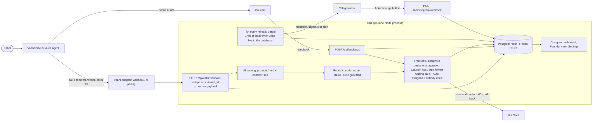
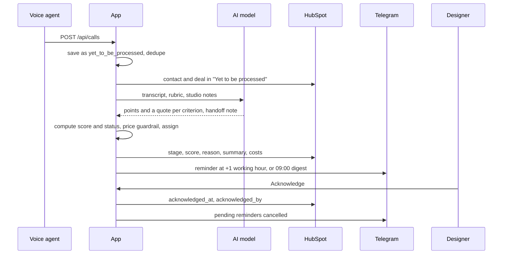

# Aangan Studios Inquiry Tracker

Handles **incoming phone calls** for Aangan Studio, an interior design studio in Pune. A voice agent answers the call. This app takes what was said, scores it against the studio's rubric, writes the designer a handoff note, assigns a designer, reminds them if they sit on it, and keeps the founder's HubSpot in step.

The problem it addresses: about 48% of enquiries get no reply within 48 hours, about a third arrive outside office hours, and replies within an hour convert at 4x. WhatsApp and the web form are out of scope here; see [Extending to WhatsApp and the web form](#extending-to-whatsapp-and-the-web-form).

**It runs end to end with no keys.** Every external service (AI, HubSpot, Telegram, Cal.com) has a mock mode that logs what it would have sent.

## Quick start

Needs Node 20.12 or newer.

```bash
npm install
cp .env.example .env
npm run db:migrate
npm run db:seed
npm run dev
```

On Windows PowerShell use `copy .env.example .env` for the second line.

Open http://localhost:3000. The seed loads 15 real (anonymised) calls through the real pipeline, so the dashboards are not empty.

Try it:
1. **Front desk**: pick a front desk officer in "Viewing as". Open a call in the To assign tab and click **Assign** (the suggested designer is already chosen). Then switch to a designer, open the **Designers** tab, open the call, read the transcript and click **Acknowledge**. Try a status override (a reason is required).
3. **Founder**: metrics, cost panel, and every call by status.
4. Watch the terminal: `[mock.telegram.send]` and `[mock.hubspot.*]` lines show what would have gone out.

The local database is a folder (`data/pglite`) holding a real Postgres that runs inside the app, so there is nothing to install or start. **It allows one process at a time**: stop `npm run dev` before running `db:migrate`, `db:seed`, `db:reset` or `telegram:link`. If you forget, the second process stops with a plain message instead of risking the data.

This repo ships an `.npmrc` that skips dependency install scripts (none are needed, and it avoids failed native builds). Make sure that file is copied with the project.

Other commands:

| Command | What it does |
|---|---|
| `npm test` | Runs the test suite |
| `npm run typecheck` | TypeScript check |
| `npm run db:check` / `db:check:neon` | Checks the database connection (local, or the Neon one in `.env.neon`) |
| `npm run smoke` / `smoke:neon` | End-to-end run of the real code against that database, with everything mocked, cleaning up afterwards |
| `npm run db:reset` | Deletes the local database (then run `db:migrate` and `db:seed`) |
| `npx tsx scripts/calibration.ts` | Prints how the 20 sample calls score under the rubric |
| `npm run telegram:link -- <designerId>` | Makes a one-time Telegram link for a designer |
| `npm run telegram:webhook` | Registers the Telegram webhook (live mode) |
| `npm run hubspot:check` | Tests the HubSpot connection and lists owner IDs (read-only; add `-- --setup` to create the properties and pipeline) |
| `npm run hubspot:reports` | Prints the founder numbers from HubSpot (live mode) |

## How it fits together



The life of one call:



It runs in two ways, with the same code:

- **Locally or on your own server:** one long-lived Node process. A timer started from `src/instrumentation.ts` ticks every minute, and Telegram is polled in-process.
- **On Vercel with Neon Postgres:** functions are short-lived, so Vercel Cron calls `GET /api/cron/tick` every minute instead, and Telegram uses a webhook. See [Deploying to Vercel and Neon](#deploying-to-vercel-and-neon).

Either way, several servers may act at once, so claiming work is done in the database, not in memory: a call is claimed before it is scored, reminders run under a lease, and acknowledgements are atomic. That is tested (`tests/serverless.test.ts`).

## The rules that must not be broken

| Rule | Where it is enforced | Tests |
|---|---|---|
| **Never quote a price, rate, range or estimate.** Any price in AI-written text is removed and flagged. | `src/lib/guardrail.ts`, applied to every generated field in `src/lib/ingest.ts`. The prompts also forbid it. | `tests/guardrail.test.ts` |
| **Never auto-reject.** A disqualified call still reaches a designer, with its reason. Designers can override with a required reason, and every override is logged. | Status is decided by code, not the model (`src/lib/rubric.ts`). Overrides: `src/lib/calls.ts`. | `tests/rubric.test.ts`, `tests/pipeline.test.ts`, `tests/dashboard.test.ts` |
| **Ambiguity is `needs_attention`, never `disqualified`.** Disqualifying needs a clear no that is quoted word for word from the transcript. | `src/lib/rubric.ts` | `tests/rubric.test.ts` |
| **1-hour SLA counts working time only** (09:00-18:00 IST, Mon-Sat, configurable). | `src/lib/working-hours.ts` | `tests/working-hours.test.ts`, `tests/reminders.test.ts` |
| **Dedupe on `external_id`; raw payload stored.** | `src/lib/ingest.ts`, unique index in `src/db/schema.ts` | `tests/pipeline.test.ts` |

One narrow exception to the price rule: a figure the **caller** said, repeated so the designer sees it, is allowed when it appears word for word in the transcript and the sentence attributes it to the caller ("Caller stated ..."). The voice agent repeating a caller's own number is not counted as the agent quoting a price.

## How a call is scored

Seven criteria, 100 points: service fit 25, project scale 20, budget realism 15, location 10, timeline and intent 15, property and decision-maker 10, next step secured 5. The model gives points and a quote for each. **Code** adds them up and decides the status:

| Score | Status |
|---|---|
| 70 to 100 | qualified |
| 25 to 69 | needs attention |
| 0 to 24 | needs attention, unless a verified clear no exists, then disqualified |

- A **verified clear no** (out-of-scope service, outside Pune and PCMC, or not a lead such as spam) caps the score at 24, so the call lands in "disqualified". This is the `CLEAR_NO_CAP` constant in `src/lib/rubric.ts`. Setting it to 69 gives the literal reading of the brief, where such calls stay in "needs attention".
- Unknown information scores about half. A budget the caller never mentioned is not a "no".
- A caller researching for someone else without saying they are authorised caps the score at 69.
- Qualified also needs non-zero service fit and location, and either a caller ID number or a booked slot. Withheld caller ID with no booking gives "No way to reach caller".
- A booked slot is worth 5 points but never qualifies a call by itself.
- Existing clients raising a complaint are not scored and go to the studio head.

`npx tsx scripts/calibration.ts` shows the result for the 20 sample calls. The rubric was checked against all of them (`tests/fixtures/gold-scores.ts`).

**Editing the AI's behaviour without touching code:** change the files in `prompts/` (`scoring_system.md`, `rubric.md`, `voice_agent.md`) and the studio notes in `context/` (`services.md`, `pricing.md`, `qualified.md`). They are read on every call. Point values in `prompts/rubric.md` are guidance for the model; the maximums and the status rules are enforced in `src/lib/rubric.ts`.

## Screens

The look is a **dark dashboard** on **Ant Design**: charcoal page and panels, one emerald accent with a soft glow on whatever is active, a left sidebar (the section you are in filled in green, red count badges for calls waiting), and one stats panel with a small tinted note under each number. Red, amber and green appear only where they mean something (overdue, needs attention, qualified). The theme is in `src/components/dash/theme.ts` and `src/app/globals.css`; the shared pieces (sidebar, page title, stat panel, list switcher, call table) are in `src/components/dash/`. The call's main action (Assign or Acknowledge) is a green card at the top of the call, the transcript is its own panel under it, and the rest are drop-downs: handoff note, booking, caller details, score, notes, timeline, and status change.

- **Front desk** (`/`): the inbox the front desk officers work from every day. **To assign** lists every qualified and needs-attention call nobody has taken yet; **Disqualified** keeps the rest visible for a second look (nothing is ever hidden or rejected); **Assigned** shows what has been handed over. Click a call and it opens right under its row, with the handoff note, score and transcript, and an **Assign to** box with the **suggested designer already selected** (the Cal.com host if the caller booked, the studio head for a complaint, otherwise whoever has the fewest waiting calls, shown next to each name). One click assigns. Until the designer acknowledges, the same box says **Reassign**.
- **Designers** (`/designers`): the next tab. Each designer sees the calls assigned to them (Pending acknowledgement, Acknowledged, All), or everyone's with "Everyone". Click a call to open it in place: handoff note, **notes** (saved with your name and the time, never edited or deleted), extracted fields, score breakdown with evidence, a **timeline** of everything that happened, the **full transcript**, a recording link when there is one, **Acknowledge**, and status override. A "today" line shows what needs you now. Search and filters keep their place, and every view and every open call has a shareable link.
- **Founder view** (`/founder`): Qualified, Disqualified (with reason), Needs attention and Yet to be processed tabs. Metrics: calls today, % acknowledged within SLA, **% assigned within target** (with average time to assign and how many the app had to assign itself), after-hours calls caught, average time to acknowledge (working time), calls with a booked slot. Calls per day (a chart), the funnel from call to consultation (calls, qualified, assigned, acknowledged, booked), a per-designer table (assigned, waiting, overdue, on-time share, average time to acknowledge), and a cost panel: AI cost per call, telephony minutes and cost per call, monthly total, cost per qualified lead.
- **Settings** (`/settings`): working hours and days, holidays, **how calls reach designers** (front desk assigns, or the app assigns on arrival), the front desk's assign deadline, the auto-assign grace period, the designer's acknowledge deadline, slot-alert lead time, AI model name, **people** (name, role: designer or front desk officer, Telegram chat ID, HubSpot owner ID, Cal.com user), and read-only integration status.

**Login is one shared password** (`APP_PASSWORD`), checked by `src/proxy.ts`, with a signed cookie that lasts 7 days. On a laptop with no password set there is no login. **In production with no password set, the app locks itself** and says why, instead of running open. The "Viewing as" selector is still just a convenience, not a security boundary: everyone who knows the password sees everything. Move to per-person accounts when more people use it.

## Reminders

Two stages, each with its own clock (all in working hours, all configurable in Settings):

| Situation | What happens |
|---|---|
| A qualified or needs-attention call arrives in working hours and nobody assigns it within 1 working hour | A reminder to each front desk officer with a **button per designer**: tap one to assign it from Telegram. |
| It still is not assigned 1 working hour after that | The app assigns it to the designer with the fewest waiting calls (or the Cal.com host) and logs it as "assigned automatically". A person's decision made a moment earlier is never overwritten. Set the grace period to 0 to switch this off. |
| A call arrives outside working hours (night, Sunday, holiday) | At 09:00 the next working day, **one** digest to each front desk officer listing every call waiting to be assigned. |
| A call is assigned | The designer is messaged straight away ("assigned to you by ...") with Open and Acknowledge. Their 1 working hour to acknowledge **starts now**, not when the caller rang. |
| The designer has not acknowledged within 1 working hour of being assigned | One reminder to that designer. |
| Booked slot is 30 minutes away and the call is not acknowledged (or not even assigned) | Urgent message to the designer, or to the front desk if nobody has it yet, with a copy to the studio head. |
| Booking cancelled or rescheduled | The call updates and whoever has it is told. |
| Designer acknowledges (dashboard, Telegram, or HubSpot) | Pending reminders for that call are cancelled. |
| A call is reassigned before acknowledgement | The previous designer's reminder is cancelled and the new designer's clock starts. After acknowledgement it can no longer be moved. |
| Disqualified calls | Nobody is chased about them. They stay visible, and an override (with a reason) brings one into the normal flow. |
| Working hours or deadlines changed in Settings | Every pending reminder is recomputed. |

Only front desk officers can assign from Telegram, and only designers can acknowledge there. In "the app assigns every call straight away" mode the first stage is skipped, and the front desk can still move a call.

Reminders carry caller name, score, status, booked slot and a deep link, with Open and Acknowledge buttons. The digest has Open buttons only, because acknowledging means "I have read this".

Jobs live in the `reminder_jobs` table; a cron ticks every minute. If the server is down when a reminder falls due, it is sent when the server comes back.

## Deploying to Vercel and Neon

The app is built to run on Vercel with a Neon Postgres database: set `DATABASE_URL` to a Neon pooled connection string, and `vercel.json` already schedules Vercel Cron to call `/api/cron/tick` every minute. Three things are **required** in production, and the app refuses to run open without them: `APP_PASSWORD` (login), `CRON_SECRET` (cron), and `INGEST_API_KEY` (the call endpoint). Step by step, with the Hobby-plan caveat: [docs/DEPLOY.md](docs/DEPLOY.md).

## Going live, one integration at a time

Set the matching `*_MODE=live` in `.env` and fill in its keys, then restart. Each can be switched independently.

| Integration | Variables | Notes |
|---|---|---|
| **AI** | `AI_MODE=live`, `ANTHROPIC_API_KEY`, `ANTHROPIC_MODEL` | One retry on invalid JSON, then the call goes to "needs attention" with an "AI failed" flag. Model name can also be changed in Settings. |
| **HubSpot** | `HUBSPOT_MODE=live`, `HUBSPOT_TOKEN`, `HUBSPOT_PORTAL_ID` | See [docs/HUBSPOT.md](docs/HUBSPOT.md) for scopes, what syncs, and building the founder dashboard. |
| **Telegram** | `TELEGRAM_MODE=live`, `TELEGRAM_BOT_TOKEN`, `TELEGRAM_WEBHOOK_SECRET`, `APP_BASE_URL` | Create a bot with BotFather. `APP_BASE_URL` must be https for the webhook. Run `npm run telegram:webhook`. In Settings press "Make a Telegram link" for each designer and send it to them. On localhost there is nothing more to do: when `APP_BASE_URL` is not https the app polls Telegram itself. |
| **Cal.com** | `CALCOM_MODE=live`, `CALCOM_WEBHOOK_SECRET` | In Cal.com add a webhook to `APP_BASE_URL/api/bookings` for booking created, rescheduled and cancelled, with that secret. Put each designer's Cal.com username or email in Settings so a booking's host maps to a designer. |

Set `INGEST_API_KEY` before exposing `POST /api/calls`; callers must then send it as header `x-api-key`.

`npm run db:seed` refuses to run while any integration is live, because it would send demo calls to real services.

**Verified live:** HubSpot (`npm run hubspot:test`), Telegram (reminders and the Acknowledge and Assign buttons), Cal.com (webhook and booking), Gemini scoring (`npm run ai:test`, 20 of 21 samples match on the first pass) and the Vaani webhook with real browser test calls. **Not yet verified:** a real phone call through Vaani (caller ID, call length) and the Anthropic provider.

## Connecting Vaani

Built from Vaani's own docs (https://docs.vaanivoice.ai). The adapter is `src/lib/voice/vaani.ts`; the webhook is `POST /api/vaani/webhook?key=<VAANI_WEBHOOK_SECRET>`.

1. **Webhook (the way it runs).** In Vaani, add the webhook URL above (the key is in the URL because Vaani documents no signature). Of Vaani's events only `call_postprocessing` matters: it carries the finished transcript and the details Vaani extracted (name, email, preferred day and time). The app saves the call, scores it, and keeps the caller's email and the requested slot.
2. **Caller number.** The finished-call event has no phone number and Vaani's call-history can fail for an account, so the number is taken from the earlier `call_started` event when Vaani sends it. Browser test calls have no number.
3. **Polling (optional).** `VAANI_INGEST_MODE=poll` makes the tick fetch finished inbound calls from Vaani's call history instead. It needs the history endpoint to work for the account.
4. **Recording.** Vaani's recording link needs the API key, so the app plays it through `/api/recording/<call id>`.
5. **Transcript.** It appears at the top of each call. If it did not arrive with the event, the Fetch from Vaani button asks Vaani again.
6. **The agent.** `prompts/voice_agent.md` is the agent's system prompt (it is already set on the agent in Vaani). It asks for the caller's name, email, and preferred day and time, never quotes a price, never asks for a phone number or budget, and answers only design questions.
7. **Booking.** The agent does not book. When a designer is assigned the app books the nearest free Cal.com slot, titled with the designer's name (`src/lib/voice/book-after-call.ts`), and replaces it if the call is moved to another designer before it is acknowledged.

## Extending to WhatsApp and the web form

The idea: a channel is just a different way to produce the same payload. Everything after ingest (scoring, assignment, the dashboards, reminders, HubSpot) is channel-neutral. The `calls.source` column already exists (it is `phone` today).

| | WhatsApp | Web form |
|---|---|---|
| `external_id` | Message or thread ID | Form submission ID |
| `caller_phone` | The WhatsApp number | The phone field (may be blank) |
| `started_at` | First message of the thread | Submission time |
| `transcript` | The thread as `Caller:` and `Agent:` lines | The fields as `Caller:` lines, for example `Caller: Location: Baner. Area: 1,100 sq ft. Timeline: January.` |
| `duration_sec` | 0 | 0 |

What to change:

1. Accept an optional `source` (`phone`, `whatsapp`, `web_form`) in `IngestPayloadSchema` and store it. Show it as a column or chip in the dashboards.
2. Charge telephony cost only when `source` is `phone` (`src/lib/cost.ts`, `processCall`).
3. Add one adapter per channel next to `src/lib/voice/`, each with its own webhook route and signature check (WhatsApp Business webhooks, or a form-to-webhook service).
4. Decide how a WhatsApp thread maps to a call. A thread grows over days, so either wait for a quiet period before ingesting, or create a new ingest per burst of messages and let the existing same-phone linking connect them.
5. Add a short note to `prompts/scoring_system.md` that form answers are structured, and that a blank field means "unknown", not "no".

The 48% unanswered figure also needs an **instant reply** on those channels. This app does not message customers. That would be a separate component (a WhatsApp auto-reply, a form confirmation email) that never quotes a price.

## Project layout

```
context/          services.md, pricing.md, qualified.md and the source transcripts (read by the AI)
prompts/          scoring_system.md, rubric.md, voice_agent.md (editable without code)
drizzle/          SQL migrations (generated by drizzle-kit)
src/app/          pages and API routes (/, /designers, /founder, /settings, /api/*)
src/components/   UI pieces
src/db/           schema and database connection
src/lib/          the logic: ingest, rubric, guardrail, ai/, reminders, telegram, hubspot/, voice/, ...
src/seed/         sample calls parsed from the transcripts
scripts/          migrate, seed, reset, calibration, telegram and hubspot helpers
tests/            vitest suites
docs/HUBSPOT.md   HubSpot setup and the founder dashboard
```

Stack: Next.js 16 (App Router), TypeScript, Tailwind 4, Postgres through Drizzle (Neon in production, PGlite locally and in tests), zod for validating the AI's JSON, node-cron for the local timer, luxon for IST time, Vitest. Drizzle was chosen over Prisma for a lighter install and plain SQL migrations. The app began on SQLite and moved to Postgres so it can run on Vercel, where there is no disk to keep a file on.

## Decisions worth knowing about

- **Status is decided by code, not the model.** The model returns points and quotes; `src/lib/rubric.ts` computes the score and status, so the safety rules cannot be broken by a bad generation.
- **A clear no must be a real quote.** If the model's quote is not found in the transcript, it is treated as "unknown" instead.
- **The digest has no Acknowledge button** (see Reminders).
- **Telegram inline Open buttons need an https `APP_BASE_URL`.** On http, the link is in the message text instead.
- **Unsent app changes beat HubSpot edits.** If the app has changes for a call that have not reached HubSpot yet, they are kept and the HubSpot edit is skipped for that round.
- **Cost figures are placeholders.** `TELEPHONY_COST_PER_MIN_INR`, `AI_INPUT_COST_PER_MTOK_INR` and `AI_OUTPUT_COST_PER_MTOK_INR` in `.env.example` are my placeholder numbers, not real prices. In mock mode the AI cost is an estimate from text length (the Founder view says so).

## Known gaps

- The Anthropic provider is untested against the real service (Gemini is the live provider).
- Vaani's call length is not known for browser test calls (the finished-call event omits it), so the call shows "length not reported".
- The Cal.com booking sits on the account owner's calendar; only its title names the designer. Putting it on each designer's own calendar needs a Cal.com team with a calendar per designer.
- Login is a single shared password, not per-person accounts.
- A real Vercel deployment has not been tried yet. The Neon database is set up and verified (`npm run db:check:neon`, `npm run smoke:neon`).
- WhatsApp and the web form are documented, not built.
- Three settings columns (`min_commercial_sqft`, `max_commercial_sqft`, `min_lead_weeks`) exist in the database but nothing reads them. The size limits live in `context/services.md` and `prompts/rubric.md`.
- `npm audit` reports 4 moderate findings, all from an old `esbuild` bundled inside `drizzle-kit`, a development-only tool that generates migrations and never serves anything. Left alone because the suggested fix downgrades `drizzle-kit` to a much older version.
- HubSpot dashboards must be built by hand (HubSpot's API cannot create reports). See [docs/HUBSPOT.md](docs/HUBSPOT.md).
