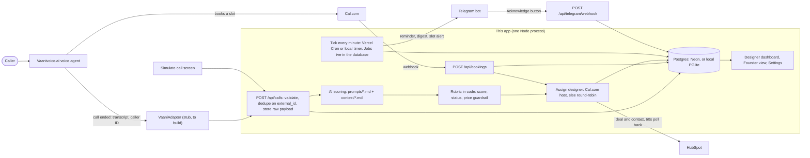
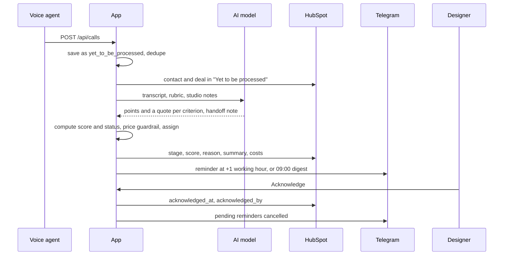

# Aangan Studio: Enquiry Desk

Handles **incoming phone calls** for Aangan Studio, an interior design studio in Pune. A voice agent answers the call. This app takes what was said, scores it against the studio's rubric, writes the designer a handoff note, assigns a designer, reminds them if they sit on it, and keeps the founder's HubSpot in step.

The problem it addresses: about 48% of enquiries get no reply within 48 hours, about a third arrive outside office hours, and replies within an hour convert at 4x. WhatsApp and the web form are out of scope here; see [Extending to WhatsApp and the web form](#extending-to-whatsapp-and-the-web-form).

**It runs end to end with no keys.** Every external service (AI, HubSpot, Telegram, Cal.com) has a mock mode that logs what it would have sent.

## Quick start

Needs Node 20.12 or newer.

```bash
npm install
cp .env.example .env
npm run db:migrate
npm run db:seed
npm run dev
```

On Windows PowerShell use `copy .env.example .env` for the second line.

Open http://localhost:3000. The seed loads 15 real (anonymised) calls through the real pipeline, so the dashboards are not empty.

Try it:
1. **Dashboard**: pick a designer in "Viewing as". Open a call, read the note, click **Acknowledge**. Try a status override (a reason is required).
2. **Simulate call**: pick a sample (or paste a transcript), choose a time of day (try "After hours" or "Sunday"), run it, then "Open in dashboard as ...".
3. **Founder**: metrics, cost panel, and every call by status.
4. Watch the terminal: `[mock.telegram.send]` and `[mock.hubspot.*]` lines show what would have gone out.

The local database is a folder (`data/pglite`) holding a real Postgres that runs inside the app, so there is nothing to install or start. **It allows one process at a time**: stop `npm run dev` before running `db:migrate`, `db:seed`, `db:reset` or `telegram:link`. If you forget, the second process stops with a plain message instead of risking the data.

This repo ships an `.npmrc` that skips dependency install scripts (none are needed, and it avoids failed native builds). Make sure that file is copied with the project.

Other commands:

| Command | What it does |
|---|---|
| `npm test` | Runs the test suite |
| `npm run typecheck` | TypeScript check |
| `npm run db:reset` | Deletes the local database (then run `db:migrate` and `db:seed`) |
| `npx tsx scripts/calibration.ts` | Prints how the 20 sample calls score under the rubric |
| `npm run telegram:link -- <designerId>` | Makes a one-time Telegram link for a designer |
| `npm run telegram:webhook` | Registers the Telegram webhook (live mode) |
| `npm run hubspot:check` | Tests the HubSpot connection and lists owner IDs (read-only; add `-- --setup` to create the properties and pipeline) |
| `npm run hubspot:reports` | Prints the founder numbers from HubSpot (live mode) |

## How it fits together



The life of one call:



It runs in two ways, with the same code:

- **Locally or on your own server:** one long-lived Node process. A timer started from `src/instrumentation.ts` ticks every minute, and Telegram is polled in-process.
- **On Vercel with Neon Postgres:** functions are short-lived, so Vercel Cron calls `GET /api/cron/tick` every minute instead, and Telegram uses a webhook. See [Deploying to Vercel and Neon](#deploying-to-vercel-and-neon).

Either way, several servers may act at once, so claiming work is done in the database, not in memory: a call is claimed before it is scored, reminders run under a lease, and acknowledgements are atomic. That is tested (`tests/serverless.test.ts`).

## The rules that must not be broken

| Rule | Where it is enforced | Tests |
|---|---|---|
| **Never quote a price, rate, range or estimate.** Any price in AI-written text is removed and flagged. | `src/lib/guardrail.ts`, applied to every generated field in `src/lib/ingest.ts`. The prompts also forbid it. | `tests/guardrail.test.ts` |
| **Never auto-reject.** A disqualified call still reaches a designer, with its reason. Designers can override with a required reason, and every override is logged. | Status is decided by code, not the model (`src/lib/rubric.ts`). Overrides: `src/lib/calls.ts`. | `tests/rubric.test.ts`, `tests/pipeline.test.ts`, `tests/dashboard.test.ts` |
| **Ambiguity is `needs_attention`, never `disqualified`.** Disqualifying needs a clear no that is quoted word for word from the transcript. | `src/lib/rubric.ts` | `tests/rubric.test.ts` |
| **1-hour SLA counts working time only** (09:00-18:00 IST, Mon-Sat, configurable). | `src/lib/working-hours.ts` | `tests/working-hours.test.ts`, `tests/reminders.test.ts` |
| **Dedupe on `external_id`; raw payload stored.** | `src/lib/ingest.ts`, unique index in `src/db/schema.ts` | `tests/pipeline.test.ts` |

One narrow exception to the price rule: a figure the **caller** said, repeated so the designer sees it, is allowed when it appears word for word in the transcript and the sentence attributes it to the caller ("Caller stated ..."). The voice agent repeating a caller's own number is not counted as the agent quoting a price.

## How a call is scored

Seven criteria, 100 points: service fit 25, project scale 20, budget realism 15, location 10, timeline and intent 15, property and decision-maker 10, next step secured 5. The model gives points and a quote for each. **Code** adds them up and decides the status:

| Score | Status |
|---|---|
| 70 to 100 | qualified |
| 25 to 69 | needs attention |
| 0 to 24 | needs attention, unless a verified clear no exists, then disqualified |

- A **verified clear no** (out-of-scope service, outside Pune and PCMC, or not a lead such as spam) caps the score at 24, so the call lands in "disqualified". This is the `CLEAR_NO_CAP` constant in `src/lib/rubric.ts`. Setting it to 69 gives the literal reading of the brief, where such calls stay in "needs attention".
- Unknown information scores about half. A budget the caller never mentioned is not a "no".
- A caller researching for someone else without saying they are authorised caps the score at 69.
- Qualified also needs non-zero service fit and location, and either a caller ID number or a booked slot. Withheld caller ID with no booking gives "No way to reach caller".
- A booked slot is worth 5 points but never qualifies a call by itself.
- Existing clients raising a complaint are not scored and go to the studio head.

`npx tsx scripts/calibration.ts` shows the result for the 20 sample calls. The rubric was checked against all of them (`tests/fixtures/gold-scores.ts`).

**Editing the AI's behaviour without touching code:** change the files in `prompts/` (`scoring_system.md`, `rubric.md`, `voice_agent.md`) and the studio notes in `context/` (`services.md`, `pricing.md`, `qualified.md`). They are read on every call. Point values in `prompts/rubric.md` are guidance for the model; the maximums and the status rules are enforced in `src/lib/rubric.ts`.

## Screens

- **Designer dashboard** (`/`): Pending acknowledgement, Acknowledged and All tabs. Each row shows time, caller, score, status, booked slot and a due-in or overdue indicator. The detail panel has the handoff note, extracted fields, score breakdown with evidence, full transcript, Acknowledge, and status override.
- **Founder view** (`/founder`): Qualified, Disqualified (with reason), Needs attention and Yet to be processed tabs. Metrics: calls today, % acknowledged within SLA, after-hours calls caught, average time to acknowledge (working time), calls with a booked slot. Cost panel: AI cost per call, telephony minutes and cost per call, monthly total, cost per qualified lead.
- **Simulate call** (`/simulate`): runs a transcript through the same pipeline as a real call.
- **Settings** (`/settings`): working hours and days, holidays, SLA, slot-alert lead time, AI model name, designers (name, Telegram chat ID, HubSpot owner ID, Cal.com user), and read-only integration status.

**Login is one shared password** (`APP_PASSWORD`), checked by `src/proxy.ts`, with a signed cookie that lasts 7 days. On a laptop with no password set there is no login. **In production with no password set, the app locks itself** and says why, instead of running open. The "Viewing as" selector is still just a convenience, not a security boundary: everyone who knows the password sees everything. Move to per-person accounts when more people use it.

## Reminders

| Situation | What happens |
|---|---|
| Call arrives in working hours, not acknowledged within 1 working hour | One reminder to the assigned designer. A call at 17:30 is due at 09:30 next working day. |
| Call arrives outside working hours (night, Sunday, holiday) | At 09:00 the next working day, **one** digest per designer listing all their pending calls. |
| Booked slot is 30 minutes away and the call is not acknowledged | Urgent message to the designer, with a copy to the studio head. |
| Booking cancelled or rescheduled | The call updates and the designer is told. |
| Designer acknowledges (dashboard, Telegram, or HubSpot) | Pending reminders for that call are cancelled. |
| Working hours or SLA changed in Settings | Every pending reminder is recomputed. |

Reminders carry caller name, score, status, booked slot and a deep link, with Open and Acknowledge buttons. The digest has Open buttons only, because acknowledging means "I have read this".

Jobs live in the `reminder_jobs` table; a cron ticks every minute. If the server is down when a reminder falls due, it is sent when the server comes back.

## Deploying to Vercel and Neon

The app is built to run on Vercel with a Neon Postgres database: set `DATABASE_URL` to a Neon pooled connection string, and `vercel.json` already schedules Vercel Cron to call `/api/cron/tick` every minute. Three things are **required** in production, and the app refuses to run open without them: `APP_PASSWORD` (login), `CRON_SECRET` (cron), and `INGEST_API_KEY` (the call endpoint). Step by step, with the Hobby-plan caveat: [docs/DEPLOY.md](docs/DEPLOY.md).

## Going live, one integration at a time

Set the matching `*_MODE=live` in `.env` and fill in its keys, then restart. Each can be switched independently.

| Integration | Variables | Notes |
|---|---|---|
| **AI** | `AI_MODE=live`, `ANTHROPIC_API_KEY`, `ANTHROPIC_MODEL` | One retry on invalid JSON, then the call goes to "needs attention" with an "AI failed" flag. Model name can also be changed in Settings. |
| **HubSpot** | `HUBSPOT_MODE=live`, `HUBSPOT_TOKEN`, `HUBSPOT_PORTAL_ID` | See [docs/HUBSPOT.md](docs/HUBSPOT.md) for scopes, what syncs, and building the founder dashboard. |
| **Telegram** | `TELEGRAM_MODE=live`, `TELEGRAM_BOT_TOKEN`, `TELEGRAM_WEBHOOK_SECRET`, `APP_BASE_URL` | Create a bot with BotFather. `APP_BASE_URL` must be https for the webhook. Run `npm run telegram:webhook`. In Settings press "Make a Telegram link" for each designer and send it to them. On localhost there is nothing more to do: when `APP_BASE_URL` is not https the app polls Telegram itself. |
| **Cal.com** | `CALCOM_MODE=live`, `CALCOM_WEBHOOK_SECRET` | In Cal.com add a webhook to `APP_BASE_URL/api/bookings` for booking created, rescheduled and cancelled, with that secret. Put each designer's Cal.com username or email in Settings so a booking's host maps to a designer. |

Set `INGEST_API_KEY` before exposing `POST /api/calls`; callers must then send it as header `x-api-key`.

`npm run db:seed` refuses to run while any integration is live, because it would send demo calls to real services.

**Not yet run against the real services.** Everything above is tested in mock mode. The live code paths for Anthropic, HubSpot, Telegram and Cal.com have not been exercised, because no keys were available. Expect to fix small things on first contact, and test each in a sandbox first. The places most likely to need adjusting are marked `TODO(verify)` in `src/lib/bookings.ts` (Cal.com payload and signature header) and `src/lib/hubspot/real.ts` (API versions).

## Connecting Vaani

The voice layer is deliberately a stub. Nothing in this repo guesses Vaani's endpoints or payloads.

What is known so far (from the studio, **not yet checked against Vaani's docs**): base URL `https://api.vaanivoice.ai`, auth header `X-API-Key`, a call-details endpoint that returns transcript, entities, evaluation and summary, and agents have an `agent_id` and a `system_prompt`. It is not confirmed whether Vaani sends end-of-call webhooks, hence `VAANI_INGEST_MODE=webhook|poll`.

Steps:

1. **Read Vaani's current API docs first.** Do not build from the notes above.
2. **Fill in `src/lib/voice/vaani.ts`.** The interface is in `src/lib/voice/provider.ts`: `verifyWebhook`, `parseWebhook`, `listCallsSince`, `fetchCall`. Each method returns the same payload that `POST /api/calls` accepts:

   | Payload field | Fill it from |
   |---|---|
   | `external_id` | Vaani's call ID (this is what makes retries safe) |
   | `caller_phone` | Caller ID. `null` if withheld. The agent never asks for it. |
   | `started_at` | Call start, ISO 8601 |
   | `duration_sec` | Call length in seconds (drives telephony cost) |
   | `transcript` | Flatten the turns to lines starting `Agent:` and `Caller:` |
   | `booking_id`, `booked_slot` | The Cal.com booking the agent made, if Vaani's call details expose it. Otherwise leave them out; the Cal.com webhook links the booking by phone number. |

3. **Wire the ingest mode.**
   - Webhook mode: add a route such as `src/app/api/vaani/webhook/route.ts` that reads the raw body, calls `voiceProvider.verifyWebhook`, then `voiceProvider.parseWebhook`, then `ingestCall(payload)` from `src/lib/ingest.ts` for each result.
   - Poll mode: in `src/lib/scheduler.ts`, call `voiceProvider.listCallsSince(cursor)` each tick, `ingestCall` each result, and store the cursor in the `app_state` table. Repeats are harmless because ingest dedupes on `external_id`.
4. **Copy `prompts/voice_agent.md` into the agent's `system_prompt`** in Vaani. It tells the agent what to ask, to never quote a price, never ask for the phone number, and never ask about budget.
5. **Test through Simulate first**, using a real transcript, before pointing live traffic at it.

## Extending to WhatsApp and the web form

The idea: a channel is just a different way to produce the same payload. Everything after ingest (scoring, assignment, the dashboards, reminders, HubSpot) is channel-neutral. The `calls.source` column already exists (it is `phone` today).

| | WhatsApp | Web form |
|---|---|---|
| `external_id` | Message or thread ID | Form submission ID |
| `caller_phone` | The WhatsApp number | The phone field (may be blank) |
| `started_at` | First message of the thread | Submission time |
| `transcript` | The thread as `Caller:` and `Agent:` lines | The fields as `Caller:` lines, for example `Caller: Location: Baner. Area: 1,100 sq ft. Timeline: January.` |
| `duration_sec` | 0 | 0 |

What to change:

1. Accept an optional `source` (`phone`, `whatsapp`, `web_form`) in `IngestPayloadSchema` and store it. Show it as a column or chip in the dashboards.
2. Charge telephony cost only when `source` is `phone` (`src/lib/cost.ts`, `processCall`).
3. Add one adapter per channel next to `src/lib/voice/`, each with its own webhook route and signature check (WhatsApp Business webhooks, or a form-to-webhook service).
4. Decide how a WhatsApp thread maps to a call. A thread grows over days, so either wait for a quiet period before ingesting, or create a new ingest per burst of messages and let the existing same-phone linking connect them.
5. Add a short note to `prompts/scoring_system.md` that form answers are structured, and that a blank field means "unknown", not "no".

The 48% unanswered figure also needs an **instant reply** on those channels. This app does not message customers. That would be a separate component (a WhatsApp auto-reply, a form confirmation email) that never quotes a price.

## Project layout

```
context/          services.md, pricing.md, qualified.md and the source transcripts (read by the AI)
prompts/          scoring_system.md, rubric.md, voice_agent.md (editable without code)
drizzle/          SQL migrations (generated by drizzle-kit)
src/app/          pages and API routes (/, /founder, /simulate, /settings, /api/*)
src/components/   UI pieces
src/db/           schema and database connection
src/lib/          the logic: ingest, rubric, guardrail, ai/, reminders, telegram, hubspot/, voice/, ...
src/seed/         sample calls parsed from the transcripts
scripts/          migrate, seed, reset, calibration, telegram and hubspot helpers
tests/            vitest suites
docs/HUBSPOT.md   HubSpot setup and the founder dashboard
```

Stack: Next.js 16 (App Router), TypeScript, Tailwind 4, Postgres through Drizzle (Neon in production, PGlite locally and in tests), zod for validating the AI's JSON, node-cron for the local timer, luxon for IST time, Vitest. Drizzle was chosen over Prisma for a lighter install and plain SQL migrations. The app began on SQLite and moved to Postgres so it can run on Vercel, where there is no disk to keep a file on.

## Decisions worth knowing about

- **Status is decided by code, not the model.** The model returns points and quotes; `src/lib/rubric.ts` computes the score and status, so the safety rules cannot be broken by a bad generation.
- **A clear no must be a real quote.** If the model's quote is not found in the transcript, it is treated as "unknown" instead.
- **The digest has no Acknowledge button** (see Reminders).
- **Telegram inline Open buttons need an https `APP_BASE_URL`.** On http, the link is in the message text instead.
- **Unsent app changes beat HubSpot edits.** If the app has changes for a call that have not reached HubSpot yet, they are kept and the HubSpot edit is skipped for that round.
- **Cost figures are placeholders.** `TELEPHONY_COST_PER_MIN_INR`, `AI_INPUT_COST_PER_MTOK_INR` and `AI_OUTPUT_COST_PER_MTOK_INR` in `.env.example` are my placeholder numbers, not real prices. In mock mode the AI cost is an estimate from text length (the Founder view says so).

## Known gaps

- Live Anthropic, HubSpot, Telegram and Cal.com paths untested against the real services.
- The Vaani adapter is a stub (by design).
- No fallback that creates a Cal.com booking after the call if the voice agent cannot book mid-call. The `POST /api/bookings` webhook already links a booking that arrives after the call, so a booking created by the app later could be fed through the same function (`applyCalEvent` in `src/lib/bookings.ts`).
- Login is a single shared password, not per-person accounts.
- The Neon/`pg` path has been tested only against PGlite (a real Postgres engine, so the SQL is the same), not yet against a live Neon database.
- WhatsApp and the web form are documented, not built.
- Three settings columns (`min_commercial_sqft`, `max_commercial_sqft`, `min_lead_weeks`) exist in the database but nothing reads them. The size limits live in `context/services.md` and `prompts/rubric.md`.
- `npm audit` reports 4 moderate findings, all from an old `esbuild` bundled inside `drizzle-kit`, a development-only tool that generates migrations and never serves anything. Left alone because the suggested fix downgrades `drizzle-kit` to a much older version.
- HubSpot dashboards must be built by hand (HubSpot's API cannot create reports). See [docs/HUBSPOT.md](docs/HUBSPOT.md).
